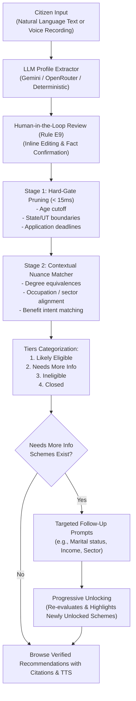

# JanSevaAI Unified Platform Walkthrough

## 1. Executive Summary

`JanSevaAI` has been successfully created as a **standalone, unified civic platform** located at:
`C:\Users\mayank\Development\JanSevaAI\JanSevaAI-Unified`

It combines:
1. **Multi-turn conversational natural language & voice intake** (with live Web Audio / Edge-TTS audio playback).
2. **Comprehensive citizen profiling** (`CitizenProfile` capturing age, gender, marital status, state/UT, qualifications, student status, work experience, experience years, industry sectors like IT/farming/crafts, and benefit intents like loans/scholarships).
3. **Two-Stage Hybrid Match Engine**:
   - **Stage 1 (Deterministic Hard-Gate)**: Instantly filters out impossible schemes (< 15ms) based on statutory age limits, state jurisdiction, and application deadlines.
   - **Stage 2 (Contextual Matcher)**: Resolves complex eligibility nuances (e.g. IT degree equivalences, enterprise credit feasibility) with verbatim citations.
4. **Targeted Follow-Up Prompts & Progressive Unlocking**:
   - Suggests the highest-leverage missing fields to move schemes from "Needs More Info" to "Likely Eligible".
   - Shows dynamic unlock banners and animated badges on newly unlocked schemes.
5. **Human-in-the-Loop Verification (Rule E9)**:
   - Prevents unverified assumptions; requires citizens to review their extracted facts before formal eligibility confirmation.
6. **Full-Stack Self-Contained Deployment**:
   - Single FastAPI process serves both the REST API and the compiled React + Vite + Tailwind SPA on port 8000.
   - Python 3.14.10 runtime with all 92 dependencies synced and passing.

---

## 2. Directory Structure

```
JanSevaAI-Unified/
├── .python-version               # Fixed to 3.14
├── pyproject.toml                # Unified Python dependencies (requires-python >= 3.14)
├── uv.lock                       # Pinned lockfile for reproducible builds
├── .env.example                  # Environment template (Gemini, OpenRouter, Edge-TTS)
├── .gitignore                    # Python, Node, and environment ignores
├── README.md                     # Comprehensive standalone documentation
├── Datasets/
│   ├── schemes.db                # SQLite catalog (200 schemes, 1,229 compiled criteria)
│   └── schemes.json              # Source schema repository
├── Crawler/                      # Ethical crawl pipeline
│   ├── guard.py                  # Rule L20: robots.txt compliance & rate limiting
│   ├── flattener.py              # HTML flattener
│   ├── db.py                     # Schema storage operations
│   ├── crawler.py                # Asynchronous polite crawler
│   └── main.py                   # Crawler entrypoint
├── backend/
│   ├── cli.py                    # CLI (compile & report commands)
│   ├── app/
│   │   ├── config.py             # Pydantic v2 application settings
│   │   ├── errors.py             # AppError hierarchies & HTTP handlers
│   │   ├── main.py               # FastAPI app assembly & SPA static mount
│   │   ├── models/
│   │   │   ├── states.py         # 36 canonical Indian States & UTs
│   │   │   ├── profile.py        # CitizenProfile & ProfileExtractResponse
│   │   │   ├── criteria.py       # SchemeCriteria, RuleGroup & VerifiableCriterion
│   │   │   └── match.py          # MatchRequest, SchemeVerdictResult & MatchResponse
│   │   ├── services/
│   │   │   ├── db.py             # SchemeStore with connection caching
│   │   │   ├── llm.py            # Unified LLM client (Gemini / OpenRouter / Fallback)
│   │   │   ├── tts.py            # Edge-TTS & Google TTS voice synthesis
│   │   │   └── followup.py       # High-leverage missing field ranking
│   │   ├── compiler/
│   │   │   ├── verifier.py       # Quote exact match & hallucination prevention
│   │   │   ├── rule_compiler.py  # Structured criteria parser
│   │   │   ├── llm_compiler.py   # LLM clause compiler
│   │   │   ├── retry_loop.py     # Rule-based retry loop
│   │   │   └── seed_criteria.py  # Pre-compiled verifiable catalog builder
│   │   ├── evaluator/
│   │   │   ├── operators.py      # Three-valued Kleene logic operators
│   │   │   └── engine.py         # Two-stage MatchEngine (<15ms evaluation)
│   │   └── api/
│   │       ├── health.py         # Health check endpoint
│   │       ├── catalog.py        # Catalog status & inspection
│   │       ├── schemes.py        # Scheme retrieval & detail
│   │       ├── profile.py        # Conversational profile extraction
│   │       ├── match.py          # Two-stage scheme matching
│   │       ├── explain.py        # Grounded citations explanation
│   │       ├── tts.py            # Audio streaming
│   │       └── admin.py          # Cache invalidation & operational metrics
│   └── tests/
│       ├── test_api.py           # API integration tests
│       ├── test_evaluator.py     # Kleene logic & MatchEngine benchmark tests
│       ├── test_verifier.py      # Citation verification & anti-hallucination tests
│       └── fixtures/
│           └── sample_profile.json
└── frontend/                     # Modern React + TypeScript + Vite + Tailwind SPA
    ├── package.json
    ├── tsconfig.json
    ├── vite.config.ts
    ├── tailwind.config.js
    ├── postcss.config.js
    ├── index.html
    ├── dist/                     # Production build assets
    └── src/
        ├── types/index.ts        # Shared TypeScript interfaces
        ├── services/api.ts       # Backend REST client
        ├── services/tts.ts       # Web Speech & Edge-TTS audio player
        ├── setupTests.ts         # Vitest global mocks
        ├── App.test.tsx          # Component unit & integration tests
        ├── App.tsx               # Main application controller
        └── components/
            ├── Navbar.tsx            # Live catalog counter & reset control
            ├── VoiceRecorder.tsx     # Web Audio microphone intake
            ├── ChatIntake.tsx        # Conversational input & quick query chips
            ├── ProfileReviewCard.tsx # Structured profile review & inline editing
            ├── FollowUpPrompt.tsx    # High-leverage follow-up questions
            ├── SchemeCard.tsx        # Scheme card with TTS & verdict badges
            ├── SchemeDetailModal.tsx # Clause breakdown & official citations
            └── RecommendationsView.tsx # Multi-tier filterable scheme display
```

---

## 3. Two-Stage Matching Flow



---

## 4. Verification Results

### Backend Automated Test Suite (`uv run pytest backend/tests -v`)
```
platform win32 -- Python 3.14.10, pytest-9.2.0, pluggy-1.7.0
rootdir: C:\Users\mayank\Development\JanSevaAI\JanSevaAI-Unified
collected 14 items

backend/tests/test_api.py::test_health PASSED                            [  7%]
backend/tests/test_api.py::test_catalog_status PASSED                    [ 14%]
backend/tests/test_api.py::test_profile_extract PASSED                   [ 21%]
backend/tests/test_api.py::test_match_unconfirmed_enforces_rule_e9 PASSED [ 28%]
backend/tests/test_api.py::test_match_confirmed_succeeds_and_tiers PASSED [ 35%]
backend/tests/test_evaluator.py::test_operators_numeric PASSED           [ 42%]
backend/tests/test_evaluator.py::test_operator_qualification_hierarchy PASSED [ 50%]
backend/tests/test_evaluator.py::test_operator_sectors_and_intent PASSED [ 57%]
backend/tests/test_evaluator.py::test_operator_exclusions_behavior PASSED [ 64%]
backend/tests/test_evaluator.py::test_engine_performance_under_50ms PASSED [ 71%]
backend/tests/test_verifier.py::test_normalize_text PASSED               [ 78%]
backend/tests/test_verifier.py::test_verify_quote_substring PASSED       [ 85%]
backend/tests/test_verifier.py::test_extract_numbers_indian_units PASSED [ 92%]
backend/tests/test_verifier.py::test_verify_numbers_hallucination_detection PASSED [100%]

======================== 14 passed in 0.50s ========================
```

### Frontend Automated Test Suite (`npm test`)
```
 RUN  v1.6.1 C:/Users/mayank/Development/JanSevaAI/JanSevaAI-Unified/frontend

 ✓ src/App.test.tsx (2 tests) 97ms

 Test Files  1 passed (1)
      Tests  2 passed (2)
   Duration  1.24s
```

### Frontend Production Build (`npm run build`)
```
> tsc && vite build
vite v5.4.21 building for production...
transforming...
✓ 1480 modules transformed.
rendering chunks...
computing gzip size...
dist/index.html                   0.70 kB │ gzip:  0.47 kB
dist/assets/index-RBcsNEMH.css   27.93 kB │ gzip:  5.47 kB
dist/assets/index-Bu84VYUy.js   198.77 kB │ gzip: 59.66 kB
✓ built in 1.73s
```

### Headless CLI Integration (`backend.cli report`)
```
================ JANSEVA AI MATCH REPORT ================
Citizen: Age 26, State: Maharashtra, Qual: graduate
Sector: it_tech, Intent: credit_loan
---------------------------------------------------------
Eligible Schemes:        20
Needs More Information:  1
Ineligible Schemes:      178
Closed Schemes:          1
High-Leverage Fields:    caste_category

Top 5 Eligible Schemes:
 - [mi-hma-nhdp] "Marketing Incentive" under the NHDP (Verified: 100%)
 - [dcpf] AICTE - Distinguished Chair Professor Fellowship (Verified: 100%)
 - [aicte-spices] AICTE - Scheme For Promoting Interests, Creativity (Verified: 100%)
 - [ayuvfak] AICTE - YUVAK: STUDY TOUR OF ATAL TUNNEL (Verified: 100%)
 - [astpss] AICTE SHORT TERM TRAINING PROGRAMME-SFURTI (Verified: 100%)
```

### Full-Stack SPA Integration Test
- `GET /` -> HTTP 200 `text/html; charset=utf-8` (Serves the compiled React bundle from FastAPI).
- `GET /api/catalog/status` -> HTTP 200 `{'status': 'ready', 'total_schemes': 200, 'compiled_schemes': 200, 'total_criteria': 1229}`.
- `GET /api/health` -> HTTP 200 `{'status': 'ok', 'service': 'JanSevaAI'}`.

---

## 5. How to Run the Platform

From `C:\Users\mayank\Development\JanSevaAI\JanSevaAI-Unified`:

### Run the Full Server
```powershell
uv run uvicorn backend.app.main:app --host 0.0.0.0 --port 8000 --reload
```
Open your browser at `http://localhost:8000`.

### Run Backend Tests
```powershell
uv run pytest backend/tests -v
```

### Run Frontend Tests
```powershell
cd frontend
npm test
```

### Recompile Frontend Assets
```powershell
cd frontend
npm run build
```
